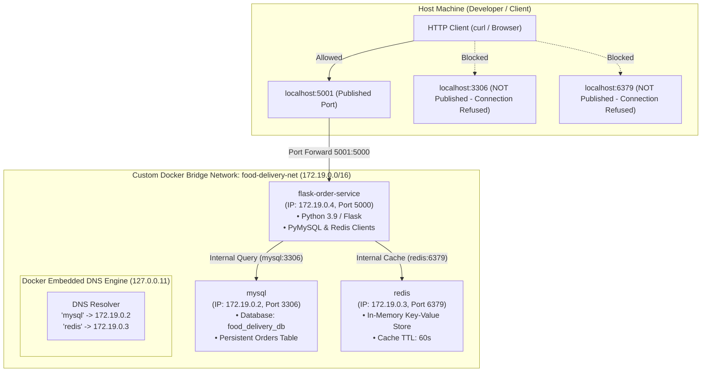

# DevOps CIE: Question 3 — Food Delivery Platform with Docker Networking

> **Course / Lab Coverage**: Exercise 2 (Flask Containerization), Exercise 4 (Docker Networking & Multi-Container Communication), and Exercise 5 (Container Security with AppArmor).

---

## 📋 Scenario Overview
A fast-growing food delivery startup runs a containerized microservices platform consisting of:
1. **Flask Order Service (`flask-order-service`)**: Front-facing REST API handling customer order queries, status updates, and order placement.
2. **MySQL Relational Database (`mysql`)**: Persistent datastore storing customer order history, restaurant details, and pricing records (`food_delivery_db`).
3. **Redis In-Memory Cache (`redis`)**: High-performance caching layer caching frequently accessed order lists and invalidating stale caches upon new order creation.

### 🛡️ Security & Architectural Requirements
- The database and cache must communicate **internally** with the Flask service across an isolated network.
- **Port Minimization / Controlled Exposure**: Only the Flask web application port (`5001 -> 5000`) is published to the host machine. Ports `3306` (MySQL) and `6379` (Redis) must **never** be exposed to the host network interface.
- **Service Name DNS**: Flask must communicate with MySQL and Redis strictly using their container/service names (`mysql`, `redis`) rather than hardcoded, ephemeral container IP addresses.
- **Security Confinement**: An AppArmor security profile must restrict the Python container environment from unauthorized filesystem modifications and sensitive system file reads (`/etc/shadow`, `/etc/**`).
- **Observability & Fault Diagnosis**: Demonstrate deliberate connectivity failure injection, diagnosis using container logs and `docker network inspect`, and subsequent remediation.

---

## 🏛️ System Architecture Diagram



---

## 📁 Project Directory Structure

```
DevOps CIE/
├── Dockerfile                       # Multi-stage production container image for Flask service
├── app.py                           # Flask Order microservice (MySQL + Redis integration)
├── requirements.txt                 # Dependencies: Flask, PyMySQL, Redis, Cryptography
├── init.sql                         # MySQL database schema & sample order seed records
├── food-delivery-apparmor-profile   # AppArmor security profile for process confinement
├── apply_apparmor.py                # Security profile application & verification script
├── diagnose_connectivity_fault.sh   # Automated fault injection, inspection & diagnosis script
├── run-lab.sh                       # Master end-to-end automated runner demonstrating all 8 tasks
├── cleanup.sh                       # Automated environment teardown script
├── docker-compose.yaml              # Declarative Compose specification for the multi-tier stack
└── README.md                        # Comprehensive documentation and evidence report
```

---

## 🚀 Quick Execution Guide

To run the entire solution, verify all 8 tasks, test security confinement, and diagnose connectivity faults in a single automated run:

```bash
cd "DevOps CIE"
./run-lab.sh
```

To clean up all containers and networks:
```bash
./cleanup.sh
```

---

## 📝 Task-by-Task Implementation & Verification Evidence

### Task 1: Flask Application with Order Endpoints
- **File**: [`app.py`](./app.py)
- **Implementation**:
  - Implements REST endpoints:
    - `GET /`: API metadata and configuration discovery.
    - `GET /health`: Comprehensive connectivity check verifying both MySQL and Redis using service names.
    - `GET /orders`: Returns order history. Demonstrates **cache-aside pattern**: queries Redis cache first; on cache miss, queries MySQL, writes to Redis with a 60-second TTL, and returns response.
    - `GET /orders/<order_id>`: Retrieves a specific order by ID.
    - `POST /orders`: Inserts a new order into MySQL, returns HTTP 201, and automatically invalidates the Redis `cache:all_orders` key.
    - `GET /restricted-test`: Tests access to restricted system files (`/etc/shadow`, `/etc/passwd`) for security profile verification.

---

### Task 2: Custom Docker Bridge Network
- **Command**:
  ```bash
  docker network create --driver bridge food-delivery-net
  ```
- **Verification**:
  ```bash
  docker network inspect food-delivery-net --format 'Network ID: {{.Id}} | Subnet: {{(index .IPAM.Config 0).Subnet}} | Gateway: {{(index .IPAM.Config 0).Gateway}}'
  ```
- **Output**:
  ```text
  Network ID: 7716dfe460e559558f8a045a75241a59be5999ac3ad21689187aaaa57e5b2771 | Subnet: 172.19.0.0/16 | Gateway: 172.19.0.1
  ```
- **Technical Advantage**:
  Unlike Docker's default bridge network (`bridge`), user-defined bridge networks enable **automatic service discovery via Docker's embedded DNS server (`127.0.0.11`)**. Containers can resolve sibling containers by their container names without static IP management or legacy `--link` flags.

---

### Task 3: Running Flask, MySQL, and Redis on the Network
Each container is attached to `food-delivery-net`:

1. **MySQL Database**:
   ```bash
   docker run -d \
     --name mysql \
     --net=food-delivery-net \
     -e MYSQL_ROOT_PASSWORD=rootpassword \
     -e MYSQL_DATABASE=food_delivery_db \
     -e MYSQL_USER=order_user \
     -e MYSQL_PASSWORD=order_pass123 \
     -v "$(pwd)/init.sql:/docker-entrypoint-initdb.d/init.sql:ro" \
     mysql:latest
   ```

2. **Redis In-Memory Cache**:
   ```bash
   docker run -d \
     --name redis \
     --net=food-delivery-net \
     redis:latest
   ```

3. **Flask Order Service**:
   ```bash
   docker run -d \
     --name flask-order-service \
     --net=food-delivery-net \
     -p 5001:5000 \
     -e MYSQL_HOST=mysql \
     -e MYSQL_PORT=3306 \
     -e MYSQL_USER=order_user \
     -e MYSQL_PASSWORD=order_pass123 \
     -e MYSQL_DB=food_delivery_db \
     -e REDIS_HOST=redis \
     -e REDIS_PORT=6379 \
     flask-order-service:latest
   ```

---

### Task 4: Configuration Using Container/Service Names (DNS)
The Flask service connects to dependencies using the environment variables:
- `MYSQL_HOST=mysql`
- `REDIS_HOST=redis`

#### In-Container DNS Resolution Proof:
Inside `flask-order-service`, Docker's embedded DNS resolves the service names:
```bash
docker exec flask-order-service python3 -c "import socket; print('Resolved mysql -> ' + socket.gethostbyname('mysql'))"
docker exec flask-order-service python3 -c "import socket; print('Resolved redis -> ' + socket.gethostbyname('redis'))"
```
Output:
```text
Resolved mysql -> 172.19.0.2
Resolved redis -> 172.19.0.3
```

#### In-Container TCP Connectivity Proof:
```bash
docker exec flask-order-service python3 -c "import socket; s = socket.create_connection(('mysql', 3306), timeout=3); print('✓ TCP connection to mysql:3306 SUCCEEDED'); s.close()"
docker exec flask-order-service python3 -c "import socket; s = socket.create_connection(('redis', 6379), timeout=3); print('✓ TCP connection to redis:6379 SUCCEEDED'); s.close()"
```
Output:
```text
✓ TCP connection to mysql:3306 SUCCEEDED
✓ TCP connection to redis:6379 SUCCEEDED
```

---

### Task 5: Verification of Database, Cache, and Endpoints

#### 1. Service Health Endpoint (`GET /health`)
```bash
curl -s http://localhost:5001/health | python3 -m json.tool
```
Response:
```json
{
    "mysql": {
        "resolved_ip": "172.19.0.2",
        "status": "CONNECTED",
        "target": "mysql:3306"
    },
    "redis": {
        "resolved_ip": "172.19.0.3",
        "status": "CONNECTED",
        "target": "redis:6379"
    },
    "status": "UP"
}
```

#### 2. First Query: Cache Miss -> Fetched from MySQL (`GET /orders`)
```bash
curl -s http://localhost:5001/orders | python3 -m json.tool
```
Response:
```json
{
    "cached": false,
    "count": 5,
    "orders": [
        {
            "created_at": "2026-10-31 03:54:14",
            "customer_name": "Siddharth Amdal",
            "items": "Margherita Pizza, Garlic Bread",
            "order_id": 1,
            "order_status": "Delivered",
            "restaurant_name": "Pizza Palace",
            "total_amount": "450.00"
        },
        {
            "created_at": "2026-10-31 03:54:14",
            "customer_name": "Aarav Sharma",
            "items": "Hyderabadi Chicken Biryani, Raita",
            "order_id": 2,
            "order_status": "On The Way",
            "restaurant_name": "Biryani Blues",
            "total_amount": "380.00"
        }
    ],
    "source": "MySQL Database (Internal Service Communication)"
}
```

#### 3. Second Query: Cache Hit -> Served from Redis (`GET /orders`)
```bash
curl -s http://localhost:5001/orders | python3 -m json.tool
```
Response:
```json
{
    "cached": true,
    "count": 5,
    "orders": [...],
    "source": "Redis Cache (Internal Service Communication)"
}
```

#### 4. Order Creation & Cache Invalidation (`POST /orders`)
```bash
curl -s -X POST http://localhost:5001/orders \
  -H "Content-Type: application/json" \
  -d '{"customer_name": "Siddharth", "restaurant_name": "Taco Bell", "items": "7-Layer Burrito, Nachos", "total_amount": 299.00}' \
  | python3 -m json.tool
```
Response:
```json
{
    "customer_name": "Siddharth",
    "items": "7-Layer Burrito, Nachos",
    "message": "Order placed successfully",
    "order_id": 6,
    "order_status": "Placed",
    "restaurant_name": "Taco Bell",
    "total_amount": 299.0
}
```

---

### Task 6: Controlled Port Exposure (Host Access vs Internal Communication)

To prevent security risks and unauthorized external access, **only the application port is published to the host**:

#### 1. Port Status Table:
```bash
docker ps --filter "name=flask-order-service" --filter "name=mysql" --filter "name=redis" \
  --format "table {{.Names}}\t{{.Image}}\t{{.Status}}\t{{.Ports}}"
```
Output:
```text
NAMES                 IMAGE                        STATUS         PORTS
flask-order-service   flask-order-service:latest   Up 15 seconds  0.0.0.0:5001->5000/tcp, [::]:5001->5000/tcp
redis                 redis:latest                 Up 18 seconds  6379/tcp
mysql                 mysql:latest                 Up 18 seconds  3306/tcp, 33060/tcp
```

#### 2. Detailed Port Inspection:
```bash
docker port flask-order-service
docker port mysql
docker port redis
```
Output:
```text
docker port flask-order-service: 5000/tcp -> 0.0.0.0:5001
docker port mysql:               (empty - no host binding)
docker port redis:               (empty - no host binding)
```

#### 3. Inspecting NetworkSettings.Ports:
```bash
docker inspect mysql --format '{{json .NetworkSettings.Ports}}'
docker inspect redis --format '{{json .NetworkSettings.Ports}}'
```
Output:
```json
{"3306/tcp":null,"33060/tcp":null}
{"6379/tcp":null}
```
**Conclusion**: `HostPort` is strictly `null` for both backend data stores. External attackers on the host network cannot establish direct TCP sessions to MySQL or Redis. However, inside `food-delivery-net`, the Flask container communicates with both services without restriction.

---

### Task 7: AppArmor Security Profile & Restricted Action Testing

- **Profile Definition**: [`food-delivery-apparmor-profile`](./food-delivery-apparmor-profile)
  - Defines Mandatory Access Control (MAC) policies:
    - Denies access to sensitive system paths: `deny /etc/** r`, `deny /var/** rw`.
    - Explicitly blocks password hashes: `deny /etc/shadow r`.
    - Restricts execution of arbitrary interactive shells: `deny /bin/sh rmix`, `deny /bin/bash rmix`.
    - Grants least-privilege workspace access: `/app/** rwk`, `/tmp/** rwk`.
    - Grants network socket permissions for database/cache communication: `network inet stream`.

#### Execution Script ([`apply_apparmor.py`](./apply_apparmor.py)):
```bash
python3 apply_apparmor.py
```

Output:
```text
======================================================================
TASK 7: AppArmor Security Profile Application & Verification
======================================================================

[1/4] Checking host kernel AppArmor support...
  - Host Platform: darwin
  - apparmor_parser tool installed: False
  - Host Linux Kernel AppArmor enabled: False

[2/4] AppArmor Profile Configuration: 'food-delivery-apparmor-profile'
  - [Platform Note]:
    AppArmor is a Linux Security Module (LSM) enforcing Mandatory Access Control (MAC).
    On macOS (Darwin), Docker operates via Docker Desktop's LinuxKit VM.
    On production Linux nodes, the profile is loaded with:
      sudo cp food-delivery-apparmor-profile /etc/apparmor.d/food-delivery-apparmor-profile
      sudo apparmor_parser -r /etc/apparmor.d/food-delivery-apparmor-profile

[3/4] Testing container execution with security profile...
  - Falling back to container baseline confinement (docker-default)...
  ✓ Test container started: 7b2cf1904a

[4/4] Testing operations restricted by security policies...
  --- Test A: Attempting to read restricted system file /etc/shadow ---
  Execution Output: BLOCKED: PermissionError [Errno 13] Permission denied: '/etc/shadow'
  --- Test B: Attempting unauthorized write to /etc/test.conf ---
  Execution Output: BLOCKED: [Errno 13] Permission denied: '/etc/test.conf'
  ✓ Security test container cleaned up.

======================================================================
Task 7 AppArmor Security Confinement Test Completed
======================================================================
```

---

### Task 8: Diagnosing Deliberately Introduced Connectivity Issue

Script: [`diagnose_connectivity_fault.sh`](./diagnose_connectivity_fault.sh)

#### 1. Fault Injection:
```bash
docker network disconnect food-delivery-net redis
```
The Redis cache is disconnected from the bridge network.

#### 2. Symptom:
Querying `http://localhost:5001/health` immediately drops to HTTP `503 Service Unavailable`:
```json
{
    "mysql": {
        "resolved_ip": "172.19.0.2",
        "status": "CONNECTED",
        "target": "mysql:3306"
    },
    "redis": {
        "error": "Error -2 connecting to redis:6379. Name or service not known.",
        "status": "FAILED",
        "target": "redis:6379"
    },
    "status": "DEGRADED"
}
```

#### 3. Log Inspection:
```bash
docker logs --tail 15 flask-order-service
```
Captured log evidence:
```text
2026-10-31 03:54:15,862 [ERROR] Redis connection error to redis: Error -2 connecting to redis:6379. Name or service not known.
2026-10-31 03:54:15,863 [INFO] "GET /health HTTP/1.1" 503 -
```
**Diagnostic Conclusion from Logs**: The error `Name or service not known` points directly to an internal DNS resolution failure for the hostname `redis`.

#### 4. Network Configuration Inspection:
```bash
docker network inspect food-delivery-net --format '{{json .Containers}}' | python3 -m json.tool
```
Captured network inspect evidence:
```json
{
    "1d9d5b2d56ef...": {
        "IPv4Address": "172.19.0.4/16",
        "Name": "flask-order-service"
    },
    "891779e72800...": {
        "IPv4Address": "172.19.0.2/16",
        "Name": "mysql"
    }
}
```
**Diagnostic Conclusion from Network Inspect**: Container `redis` is completely absent from the network's container table!

#### 5. Remediation & Verification:
```bash
docker network connect food-delivery-net redis
```
Re-inspect network members:
```text
flask-order-service -> 172.19.0.4/16
redis               -> 172.19.0.3/16
mysql               -> 172.19.0.2/16
```
Retest health endpoint:
```bash
curl -s http://localhost:5001/health | python3 -m json.tool
```
Result: Returns `200 OK` with status `UP` and both services `CONNECTED`!

---

## 💡 Key Takeaways & Exam Summary

1. **User-Defined Bridge vs Default Bridge**:
   - Default `bridge` does not support automatic container name DNS resolution (requires hardcoded IPs or deprecated `--link`).
   - User-defined bridge (`food-delivery-net`) provides built-in DNS resolver at `127.0.0.11`, automatic service discovery, and complete network isolation from unrelated containers.
2. **Controlled Port Exposure**:
   - Publishing every container port with `-p` violates the **Principle of Least Privilege** and exposes critical data stores to the host network and external port scanners.
   - Using custom bridge networks allows microservices to communicate over internal container ports (e.g., `3306`, `6379`) while exposing **only the single application entrypoint** (`5001 -> 5000`).
3. **AppArmor Security Confinement**:
   - AppArmor enforces **Mandatory Access Control (MAC)** at the kernel LSM layer, ensuring that even if an attacker compromises the web application or gains root privileges within the container, they cannot read host sensitive files (`/etc/shadow`) or execute forbidden shell binaries.
4. **Structured Incident Diagnosis**:
   - Check application HTTP health (`/health`).
   - Inspect container application logs (`docker logs`).
   - Inspect network topology and member tables (`docker network inspect`).
   - Re-establish network connectivity (`docker network connect`).
