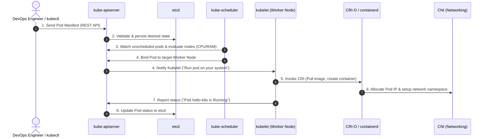

# Exercise 1: Hello Pod (Zepto Storefront Deployment)

> 🔗 **Original Lab Exercise**: [1-Kubernetes-Getting-Started.md](https://github.com/SunagP/DevOps-Lab/blob/main/Exercises/1-Kubernetes-Getting-Started.md)

## Business Problem
At **Zepto**, the product engineering team built a lightweight web app that renders the customer-facing storefront and live delivery tracking status. As a DevOps Engineer, your mission is to deploy this containerized application onto Kubernetes so that it is continuously available, portable, and ready for horizontal scaling.

In this introductory exercise, we simulate the storefront web application using the official `nginx` container image.

---

## Exercise Implementation Roadmap

- [x] **Phase 1: Pod Definition & Deployment**
  - Setup local cluster prerequisites (Minikube / Docker).
  - Define declarative Pod manifest (`pod.yaml`).
  - Deploy and verify Pod runtime status using `kubectl`.
- [x] **Phase 2: Service Exposure & Traffic Routing (NodePort)**
  - Expose the running Pod to external traffic using a NodePort Service.
  - Verify network routing and browse the Zepto storefront.
- [x] **Phase 3: System Internals & Lifecycle Deep Dive**
  - Document the 8-stage Kubernetes control plane and worker node lifecycle (API Server, etcd, Scheduler, Kubelet, CRI, CNI).
  - Provide automated helper scripts for deployment validation and teardown.

---

## Phase 1: Pod Definition & Deployment

### 1. Prerequisites Setup
Ensure a container runtime (Docker Desktop / OrbStack / Colima) and Minikube are installed.

On macOS (via Homebrew):
```bash
brew install minikube
```

Verify tools:
```bash
kubectl version --client
minikube version
```

Start your local Kubernetes cluster:
```bash
minikube start --driver=docker
```

---

### 2. Deploying the Storefront Pod

#### Option A: Declarative Deployment (Recommended - Infrastructure as Code)
Deploy using the included [`pod.yaml`](./pod.yaml):
```bash
kubectl apply -f "Exercise 1/pod.yaml"
```

#### Option B: Imperative Command (Quick CLI run)
```bash
kubectl run hello-k8s --image=nginx --port=80
```

---

### 3. Verification & Inspection

Check that the Pod is up and transitioning to the `Running` state:
```bash
kubectl get pods -o wide
```

Inspect detailed container state, events, and assigned IP:
```bash
kubectl describe pod hello-k8s
```

View application logs:
```bash
kubectl logs hello-k8s
```

---

## Phase 2: Service Exposure & Traffic Routing (NodePort)

### 1. Why a Kubernetes Service?
In Kubernetes, Pods are ephemeral by design. When a Pod crashes or is rescheduled, its internal IP address changes. A **Service** acts as an abstraction layer with a stable IP, DNS name, and load balancer that automatically routes traffic to the Pods matching its label selector (`app: hello-k8s`).

For this exercise, we use a `NodePort` service, which opens an external port on every worker node in the cluster, forwarding incoming requests to port `80` of the Nginx container.

---

### 2. Exposing the Pod

#### Option A: Declarative Service (Recommended)
Deploy the service using [`service.yaml`](./service.yaml):
```bash
kubectl apply -f "Exercise 1/service.yaml"
```

#### Option B: Imperative Command
Expose the existing Pod directly via `kubectl`:
```bash
kubectl expose pod hello-k8s --type=NodePort --port=80
```

---

### 3. Verifying the Service & Endpoints

Inspect the created Service:
```bash
kubectl get services -o wide
```

Verify that the Service has registered the Pod's internal IP address under its `Endpoints`:
```bash
kubectl get endpoints hello-k8s
```

View detailed configuration (including assigned NodePort in range 30000–32767):
```bash
kubectl describe service hello-k8s
```

---

### 4. Accessing the Zepto Storefront

#### Method 1: Using Minikube Service Tunnel (Direct Browser Launch)
Launch the browser automatically or fetch the dynamically routed URL:
```bash
minikube service hello-k8s
```
To print only the accessible URL:
```bash
minikube service hello-k8s --url
```

#### Method 2: Port-Forwarding (Universal Local Access)
You can forward local port `8080` directly to the service:
```bash
kubectl port-forward service/hello-k8s 8080:80
```
Then visit `http://localhost:8080` in your web browser or test with `curl`:
```bash
curl -I http://localhost:8080
```
Expected output:
```http
HTTP/1.1 200 OK
Server: nginx/...
Content-Type: text/html
```

---

## Phase 3: System Internals & Lifecycle Deep Dive

### 1. Kubernetes Architecture & Lifecycle Diagram
When you run `kubectl run hello-k8s --image=nginx --port=80` or apply `pod.yaml`, Kubernetes coordinates between its **Control Plane** and **Worker Node** components across an 8-stage lifecycle:



---

### 2. Detailed 8-Stage Lifecycle Breakdown

#### ➊ CLI to API Server (`kubectl` $\rightarrow$ `kube-apiserver`)
* **Action**: The developer executes `kubectl apply -f pod.yaml` or `kubectl run`.
* **Mechanism**: `kubectl` serializes the YAML definition into a JSON payload and makes an HTTPS REST API call (`POST /api/v1/namespaces/default/pods`) against `kube-apiserver`.
* **Concept**: *"Dear Kubernetes, please create this pod for me."*

#### ➋ Validation & State Persistence (`kube-apiserver` $\rightarrow$ `etcd`)
* **Action**: The API Server acts as the cluster gatekeeper.
* **Mechanism**: It authenticates the requester, checks RBAC permissions, and passes the manifest through admission controllers. Once validated, it persists the desired Pod specification into `etcd` (the distributed, consistent key-value store).
* **Concept**: *"There should be a Pod called hello-k8s running an nginx container on port 80."*

#### ➌ Node Selection (`kube-scheduler`)
* **Action**: The scheduler detects the unscheduled Pod.
* **Mechanism**: `kube-scheduler` continuously watches `kube-apiserver` for Pods where `nodeName` is unassigned. It runs a two-step algorithm:
  1. **Filtering (Predicates)**: Filters out nodes lacking sufficient CPU or memory.
  2. **Scoring (Priorities)**: Ranks surviving candidate nodes to select the optimal worker node.

#### ➍ Scheduling Binding (`kube-scheduler` $\rightarrow$ `kubelet`)
* **Action**: Binding the Pod to a specific worker node.
* **Mechanism**: The scheduler sends a `Binding` object back to `kube-apiserver`, which updates `etcd`. The `kubelet` agent running as a system daemon on that specific worker node detects the assigned workload via its active API Server watch.
* **Concept**: *"You run this pod on your system."*

#### ➎ Container Runtime Execution (`kubelet` $\rightarrow$ `CRI-O` / `containerd`)
* **Action**: Instantiating the container runtime.
* **Mechanism**: `kubelet` issues gRPC commands over the Container Runtime Interface (CRI) to the container engine (such as CRI-O or containerd):
  - Pulls the `nginx` image from Docker Hub (if not locally cached).
  - Sets up root filesystems, volume mounts, and container metadata.
  - Launches the container process isolated inside Linux kernel namespaces (`PID`, `mount`, `UTS`, `IPC`, `network`) bounded by `cgroups` (CPU and RAM constraints).

#### ➏ Network Allocation (`CNI`)
* **Action**: Providing networking capabilities.
* **Mechanism**: The container runtime triggers the Container Network Interface (CNI) plugin (e.g., Minikube bridge, Calico, or Cilium).
* **Concept**: The CNI assigns a unique, routable cluster IP address to the Pod's network namespace and configures virtual ethernet (`veth`) pairs bridging the container to the host node.

#### ➐ Status Reporting (`kubelet` $\rightarrow$ `kube-apiserver`)
* **Action**: Notifying the cluster of readiness.
* **Mechanism**: `kubelet` queries CRI for container status, executes configured startup and liveness probes, and reports back to `kube-apiserver`:
* **Concept**: *"Pod hello-k8s is running."* The API server updates the object's status in `etcd`, reflecting the transition from `ContainerCreating` to `Running`.

#### ➑ Service Traffic Routing (`kube-proxy`)
* **Action**: Routing external and internal requests.
* **Mechanism**: On the worker node, `kube-proxy` watches for Service and Endpoint objects. When the `hello-k8s` NodePort Service is created:
  - `kube-proxy` configures kernel `iptables` or `IPVS` packet forwarding rules.
  - When traffic arrives at the node's assigned `NodePort` (30000–32767), packet translation (DNAT) redirects requests directly to the Pod's CNI-assigned IP on port `80`.

---

### 3. Automated Helper Scripts

For streamlined operations and repeatability, helper scripts are provided:

#### Quick Deploy
Deploys the Pod, waits for readiness, applies the Service, and prints endpoints:
```bash
./"Exercise 1/deploy.sh"
```

#### Quick Teardown
Deletes the Service and Pod cleanly from the cluster:
```bash
./"Exercise 1/cleanup.sh"
```

---

### 4. DevOps Troubleshooting Guide

| Issue | Typical Root Cause | Diagnostic Command | Remediation |
| :--- | :--- | :--- | :--- |
| **Pending Pod** | Insufficient CPU/Memory or no available node | `kubectl describe pod hello-k8s` | Check node capacity (`kubectl describe nodes`) or lower resource requests in `pod.yaml`. |
| **ImagePullBackOff** | Typo in image name or private registry access missing | `kubectl describe pod hello-k8s` | Verify container image tag and availability on Docker Hub. |
| **CrashLoopBackOff** | Container process exits immediately upon launch | `kubectl logs hello-k8s` | Check application startup commands or entrypoints. |
| **Service Not Routing** | Label selector mismatch | `kubectl get endpoints hello-k8s` | Ensure `service.yaml` selector (`app: hello-k8s`) exactly matches `pod.yaml` labels. |


