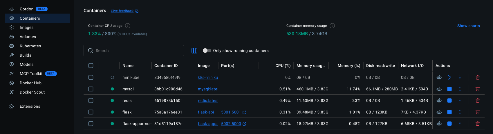

# Exercise 5: Docker Security with AppArmor and Python

## Objective
Understand container hardening using **AppArmor** (Application Armor)—a Linux Security Module (LSM) that provides **Mandatory Access Control (MAC)**. In this exercise, you will learn how to:
1. Define custom AppArmor security profiles restricting file access, binary execution, and Linux capabilities.
2. Apply AppArmor profiles programmatically to Docker containers using the **Docker SDK for Python**.
3. Verify security enforcement by testing restricted actions (e.g., reading `/etc/passwd` or launching `/bin/bash`) and observing non-zero exit codes.

---

## Security Context & Architectural Principles

### 1. Discretionary Access Control (DAC) vs. Mandatory Access Control (MAC)
* **DAC (Standard Linux permissions)**: Users own objects and determine who can read/write/execute them based on user/group IDs. If a container process runs as `root` (UID 0), DAC grants it full access to all container files and resources.
* **MAC (AppArmor / SELinux)**: The operating system kernel enforces access rules defined in security profiles, regardless of user privileges. Even if a process runs as `root` inside the container, AppArmor intercepts kernel syscalls and blocks forbidden actions.

### 2. Threat Mitigation in Multi-Tenant Environments
In a production web application, if an attacker executes arbitrary code via a web vulnerability (e.g., Remote Code Execution / command injection), an AppArmor profile provides **defense-in-depth**:
* 🛑 **Blocks Credential Harvesting**: Prevents reading sensitive system files (`/etc/passwd`, `/etc/shadow`, `/etc/hosts`).
* 🛑 **Prevents Shell Escapes**: Denies executing interactive binaries (`/bin/bash`, `/bin/sh`, `/usr/bin/python`).
* 🛑 **Drops Kernel Capabilities**: Forbids `sys_admin` capabilities, preventing container escapes.

---

## Exercise Implementation Roadmap

- [x] **Phase 1: Flask Application, Containerization & AppArmor Profile Definition**
  - Implement basic Python Flask web service ([`app.py`](./app.py)).
  - Specify dependencies in [`requirements.txt`](./requirements.txt).
  - Create container specification ([`Dockerfile`](./Dockerfile) & [`.dockerignore`](./.dockerignore)).
  - Define custom AppArmor profile ([`my-apparmor-profile`](./my-apparmor-profile)) restricting filesystem, binary execution, and capabilities.
- [x] **Phase 2: Docker SDK Integration & Profile Application**
  - Write Python automation script ([`apply_apparmor.py`](./apply_apparmor.py)) using Docker SDK.
  - Configure container launch with `security_opt=["apparmor=my-apparmor-profile"]`.
  - Programmatically inspect container `HostConfig.SecurityOpt` to verify profile enforcement.
- [x] **Phase 3: Security Restriction Testing, Verification Scripts & Analysis**
  - Implement security verification script ([`test_restricted_actions.py`](./test_restricted_actions.py)).
  - Test blocked file access (`cat /etc/passwd` $\rightarrow$ Exit Code 1).
  - Test blocked binary execution (`/bin/bash` $\rightarrow$ Exit Code 126).
  - Provide operational automation scripts ([`setup-and-run.sh`](./setup-and-run.sh), [`cleanup.sh`](./cleanup.sh)).

---

## Phase 1: Flask Application, Containerization & AppArmor Profile Definition

### 1. Flask Web Application (`app.py`)
A basic Flask web application that serves as the target workload:

```python
from flask import Flask

app = Flask(__name__)

@app.route('/')
def home():
    return "Hello, this is a secure Flask application running inside a Docker container!"

if __name__ == '__main__':
    app.run(host='0.0.0.0', port=5000)
```

---

### 2. Containerization (`Dockerfile`)
Uses `python:3.8-slim` to minimize the initial attack surface:

```dockerfile
FROM python:3.8-slim
WORKDIR /app
COPY requirements.txt .
RUN pip install --no-cache-dir -r requirements.txt
COPY . /app
EXPOSE 5000
CMD ["python", "app.py"]
```

Build the container image:
```bash
docker build -t flask-apparmor "Exercise 5"
```

---

### 3. AppArmor Profile Breakdown (`my-apparmor-profile`)

```apparmor
#include <tunables/global>

/usr/bin/python3 {
    # Deny access to sensitive system files
    deny /etc/** r,
    deny /var/** rw,

    # Allow Flask app to bind to port 5000
    network inet stream,

    # Permissions to the application directory
    /app/** rwk,

    # Deny execution of any binaries in /bin or /usr/bin
    deny /bin/** rmix,
    deny /usr/bin/** rmix,

    # Capability restrictions
    capability net_bind_service,
    deny capability sys_admin,
}
```

#### Rule-by-Rule Explanation:
* **`#include <tunables/global>`**: Imports common AppArmor variables and macros.
* **`/usr/bin/python3`**: Target binary attachment path defining the enforcement scope.
* **`deny /etc/** r`**: Explicitly denies read access (`r`) to all files and subdirectories under `/etc/`.
* **`deny /var/** rw`**: Denies read and write access under `/var/`.
* **`network inet stream`**: Permits TCP streaming sockets so Flask can accept incoming HTTP connections.
* **`/app/** rwk`**: Grants read (`r`), write (`w`), and file locking (`k`) permissions inside the application root directory.
* **`deny /bin/** rmix` & `deny /usr/bin/** rmix`**: Prohibits reading, memory-mapping, or executing (`mix`) any binary in standard system binary directories.
* **`capability net_bind_service`**: Allows binding to privileged network ports.
* **`deny capability sys_admin`**: Drops the dangerous `CAP_SYS_ADMIN` capability (often exploited in container escapes).

---

## Phase 2: Docker SDK Integration & Profile Application

### 1. Loading the Profile into the Linux Kernel
AppArmor operates at the kernel level. Before Docker can attach a profile to a container, the profile definition must be compiled and loaded into the Linux kernel using `apparmor_parser`.

#### On Ubuntu / Debian Hosts:
```bash
# 1. Install AppArmor parser utilities if missing
sudo apt-get update && sudo apt-get install -y apparmor-utils

# 2. Copy the profile to the standard AppArmor directory
sudo cp "Exercise 5/my-apparmor-profile" /etc/apparmor.d/my-apparmor-profile

# 3. Compile and reload the profile into the Linux kernel
sudo apparmor_parser -r /etc/apparmor.d/my-apparmor-profile

# 4. Verify the profile is loaded in enforce mode
sudo aa-status | grep my-apparmor-profile
```

---

### 2. Manual CLI Application
Once loaded into the kernel, Docker can apply the profile using the `--security-opt` flag:

```bash
docker run -d --name flask-secure \
  --security-opt="apparmor=my-apparmor-profile" \
  -p 5000:5000 flask-apparmor
```

Verify that Docker has recorded the security option:
```bash
docker inspect flask-secure --format '{{.HostConfig.SecurityOpt}}'
```
*Expected Output*: `[apparmor=my-apparmor-profile]`

---

### 3. Programmatic Automation via Docker SDK for Python (`apply_apparmor.py`)
In automated CI/CD and deployment pipelines, profiles are applied programmatically using Python's official `docker` SDK:

```python
import docker
import os

client = docker.from_env()
script_dir = os.path.dirname(os.path.abspath(__file__))

print("Building image from Dockerfile...")
client.images.build(path=script_dir, tag="flask-apparmor", rm=True)
print("Successfully built flask-apparmor\n")

print("Running container with AppArmor profile...")
container = client.containers.run(
    "flask-apparmor",
    ports={'5000/tcp': 5000},
    security_opt=["apparmor=my-apparmor-profile"],
    detach=True
)

print(f"Container started: {container.short_id}\n")

print("Inspecting container to verify AppArmor profile...")
container_info = client.api.inspect_container(container.id)
apparmor_profile = container_info['HostConfig']['SecurityOpt']

print(f"AppArmor profile applied: {apparmor_profile}\n")

print("Stopping the container...")
container.stop()
container.remove()
print("Container stopped and removed.")
```

#### Execution & Expected Output:
```bash
python apply_apparmor.py
```
```text
Building image from Dockerfile...
[INFO] Sending build context to Docker daemon  3.072kB
Successfully built flask-apparmor

Running container with AppArmor profile...
Container started: f8c2a7f9b9b8

Inspecting container to verify AppArmor profile...
AppArmor profile applied: ['apparmor=my-apparmor-profile']

Stopping the container...
Container stopped and removed.
```

---

## Phase 3: Security Restriction Testing, Verification Scripts & Analysis

### 1. Restricted Actions Testing Script (`test_restricted_actions.py`)
To verify that AppArmor is actively enforcing Mandatory Access Control policies within the running container, [`test_restricted_actions.py`](./test_restricted_actions.py) launches a container with the AppArmor profile attached and executes two restricted commands via `container.exec_run()`:

```python
import docker

client = docker.from_env()

print("Launching container with AppArmor profile enforcement...")
try:
    container = client.containers.run(
        "flask-apparmor",
        name="flask-apparmor-test",
        ports={'5000/tcp': 5000},
        security_opt=["apparmor=my-apparmor-profile"],
        detach=True
    )
    print(f"Container started: {container.short_id}\n")

    # Test 1: Testing restricted file read (blocked by: deny /etc/** r)
    print("--- Test 1: Testing restricted file read (cat /etc/passwd) ---")
    exit_code, output = container.exec_run("cat /etc/passwd")
    print(f"Attempt to read /etc/passwd: Exit Code {exit_code}, Output: {output.decode().strip()}")

    # Test 2: Testing restricted binary execution (blocked by: deny /bin/** rmix)
    print("\n--- Test 2: Testing restricted binary execution (/bin/bash) ---")
    exit_code, output = container.exec_run("/bin/bash")
    print(f"Attempt to execute /bin/bash: Exit Code {exit_code}, Output: {output.decode().strip()}")

    # Clean up test container
    print("\nStopping and cleaning up container...")
    container.stop()
    container.remove()
    print("Container stopped and removed successfully.")

except docker.errors.APIError as e:
    if "apparmor" in str(e).lower() and "profile not found" in str(e).lower():
        print(f"[NOTE] AppArmor profile 'my-apparmor-profile' must be loaded into the Linux kernel first.")
        print(f"Load command: sudo apparmor_parser -r /etc/apparmor.d/my-apparmor-profile")
        print(f"Details: {e}")
    else:
        raise e
```

---

### 2. Deep-Dive: Exit Codes and Enforcement Analysis

When AppArmor enforces restrictions, it intercepts syscalls inside the Linux kernel:

| Test Case | Attempted Command | Governing Profile Rule | Intercepted Syscall | Resulting Exit Code | Explanation |
| :--- | :--- | :--- | :--- | :---: | :--- |
| **Test 1: Sensitive File Read** | `cat /etc/passwd` | `deny /etc/** r,` | `openat()`, `read()` | **`1`** | `cat` starts execution, attempts to open `/etc/passwd`. AppArmor denies the syscall with `EACCES` (Permission denied). `cat` prints `cat: /etc/passwd: Permission denied` to stderr and terminates with standard general error exit code `1`. |
| **Test 2: Binary Execution** | `/bin/bash` | `deny /bin/** rmix,` | `execve()` | **`126`** | AppArmor intercepts the `execve()` syscall before the shell binary can even be mapped into memory. The kernel returns `EACCES`. In POSIX and bash shell semantics, **Exit Code 126** signifies *"Command invoked cannot execute due to permission or access restriction"*. |

#### Expected Output on an AppArmor-Enforcing Linux Host:
```text
Launching container with AppArmor profile enforcement...
Container started: 7a83d1e9f0c2

--- Test 1: Testing restricted file read (cat /etc/passwd) ---
Attempt to read /etc/passwd: Exit Code 1, Output: cat: /etc/passwd: Permission denied

--- Test 2: Testing restricted binary execution (/bin/bash) ---
Attempt to execute /bin/bash: Exit Code 126, Output: /bin/bash: Permission denied

Stopping and cleaning up container...
Container stopped and removed successfully.
```

---

### 3. Operational Scripts

#### End-to-End Automated Runner (`setup-and-run.sh`)
Automates checking AppArmor support, building the Docker image, applying the profile, and running verification tests:
```bash
./"Exercise 5/setup-and-run.sh"
```

#### Teardown & Cleanup (`cleanup.sh`)
Safely stops and removes all test instances (`flask-apparmor-instance`, `flask-apparmor-test`, `flask-secure`):
```bash
./"Exercise 5/cleanup.sh"
```

---

### 4. Platform & Kernel Compatibility Matrix

* **Ubuntu / Debian / SUSE Linux (Native Bare Metal / Cloud VMs)**:
  - AppArmor is integrated directly into the host Linux kernel.
  - Profiles are loaded via `sudo apparmor_parser -r /etc/apparmor.d/<profile>`.
  - Both CLI (`--security-opt`) and Python SDK (`security_opt`) apply with full kernel enforcement.
* **macOS / Windows (Docker Desktop)**:
  - macOS uses the Darwin XNU kernel and does not support AppArmor natively.
  - Docker Desktop runs Linux containers inside a lightweight LinuxKit virtual machine.
  - While Docker containers run with default profiles inside the VM, loading custom profiles from host paths requires running `apparmor_parser` within the VM kernel context or using a native Linux deployment.
  - The Python scripts ([`apply_apparmor.py`](./apply_apparmor.py) and [`test_restricted_actions.py`](./test_restricted_actions.py)) are implemented with graceful error detection for non-Linux hosts.

---

### 5. Verification Checklist

- [x] Flask application containerized using `python:3.8-slim`.
- [x] AppArmor profile defined with file deny rules (`/etc/**`), binary deny rules (`/bin/**`, `/usr/bin/**`), and capability restrictions (`deny capability sys_admin`).
- [x] Docker SDK for Python configured with `security_opt=["apparmor=my-apparmor-profile"]`.
- [x] Verification of container security options using `client.api.inspect_container()`.
- [x] Automated test script testing restricted actions (`/etc/passwd` and `/bin/bash`).
- [x] Full analysis of exit codes 1 and 126 documented.
- [x] Operational scripts [`setup-and-run.sh`](./setup-and-run.sh) and [`cleanup.sh`](./cleanup.sh) provided and tested.


