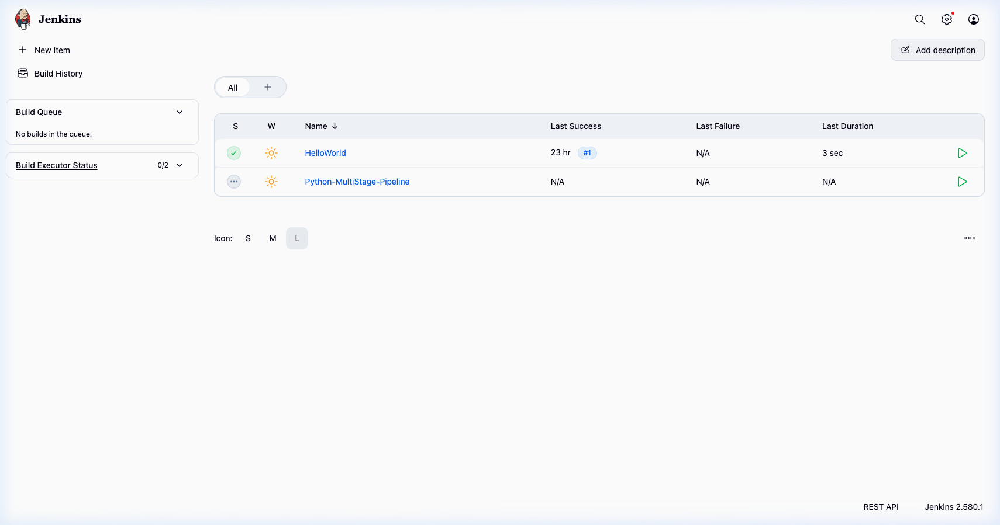
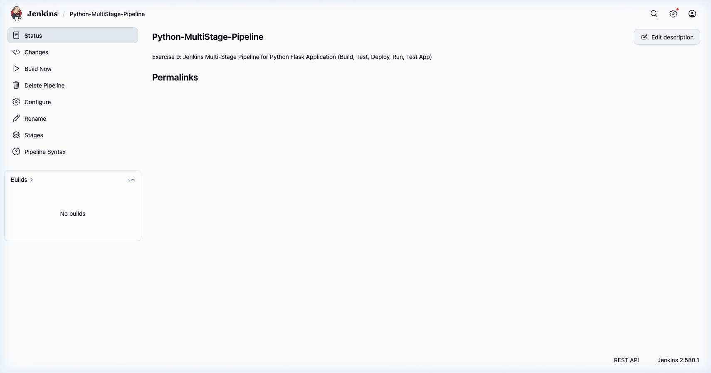

# Exercise 9: Jenkins Multi-Stage Pipeline - Deploying a Python Application

> 🔗 **Original Lab Exercise**: [9-Jenkins-Multi-Stage-Pipeline.md](https://github.com/SunagP/DevOps-Lab/blob/main/Exercises/9-Jenkins-Multi-Stage-Pipeline.md)

## Objective
The objective of this exercise is to implement and manage an automated, multi-stage **Jenkins Pipeline** as Code (`Jenkinsfile`) for a Python Flask application. This exercise demonstrates how to automate continuous integration, unit testing, mock deployment, live process execution, and runtime verification within an orchestrated CI/CD lifecycle.

In this exercise, you will:
1. Understand **Declarative Jenkins Pipelines** (`pipeline { ... }`) and the benefits of **Pipeline as Code** over classic Freestyle jobs.
2. Develop a modular Python Flask microservice ([`app.py`](./python-flask-app/app.py)) and comprehensive unit test suite ([`test_app.py`](./python-flask-app/test_app.py)).
3. Define a structured `Jenkinsfile` executing five key stages: **Build**, **Test**, **Deploy**, **Run Application**, and **Test Application**.
4. Configure Git Source Code Management (SCM) to pull the pipeline definition directly from version control (`https://github.com/SiddharthAmdal/DEVOPS.git`).
5. Troubleshoot and resolve container environment dependencies inside the Dockerized Jenkins controller (`python3`, `pip`, `venv`, `flask`).
6. Enforce lifecycle hygiene via `post` actions to terminate background application processes and ensure reproducible builds without port conflicts.

---

## Architectural Workflow: Declarative Pipeline Lifecycle

```
+----------------------------------------------------------------------------------------------------+
|                                    Jenkins CI/CD Declarative Pipeline                              |
+----------------------------------------------------------------------------------------------------+
                                                  |
                                                  v
                     +---------------------------------------------------------+
                     | 1. SCM Checkout                                         |
                     | Git clone from https://github.com/.../DEVOPS.git         |
                     | Loads: Exercise 9/Jenkinsfile                           |
                     +---------------------------------------------------------+
                                                  |
                                                  v
                     +---------------------------------------------------------+
                     | 2. Stage: Build                                         |
                     | Resolves source & installs dependencies:                |
                     | pip install -r requirements.txt                         |
                     +---------------------------------------------------------+
                                                  |
                                                  v
                     +---------------------------------------------------------+
                     | 3. Stage: Test                                          |
                     | Executes automated unit tests:                          |
                     | python3 -m unittest discover -s .                       |
                     +---------------------------------------------------------+
                                                  |
                                                  v
                     +---------------------------------------------------------+
                     | 4. Stage: Deploy                                        |
                     | Packages application artifacts into deployment folder:  |
                     | mkdir -p ${WORKSPACE}/python-app-deploy                 |
                     | cp app.py ${WORKSPACE}/python-app-deploy/               |
                     +---------------------------------------------------------+
                                                  |
                                                  v
                     +---------------------------------------------------------+
                     | 5. Stage: Run Application                               |
                     | Launches Flask app as a daemonized background process:  |
                     | nohup python3 python-app-deploy/app.py > app.log 2>&1 & |
                     | Records process ID to app.pid                           |
                     +---------------------------------------------------------+
                                                  |
                                                  v
                     +---------------------------------------------------------+
                     | 6. Stage: Test Application                              |
                     | Executes runtime verification tests:                    |
                     | python3 test_app.py                                     |
                     +---------------------------------------------------------+
                                                  |
                                                  v
                     +---------------------------------------------------------+
                     | 7. Post Lifecycle Actions (Always / Success / Failure)  |
                     | - Post 'always': Gracefully kill PID from app.pid       |
                     | - Post 'success': "Pipeline completed successfully!"    |
                     | - Post 'failure': "Pipeline failed. Check the logs."    |
                     +---------------------------------------------------------+
```

---

## Directory Structure

```
Exercise 9/
├── Jenkinsfile                   # Declarative pipeline script for SCM execution
├── build-job.sh                  # Automated script to trigger build and stream console logs
├── cleanup.sh                    # Automated teardown script for pipeline job & processes
├── create-job.sh                 # REST API script to configure Python-MultiStage-Pipeline
├── install-prereqs.sh            # Script to install python3/pip/flask in Jenkins container
├── jenkins_dashboard.png         # Screenshot of Jenkins dashboard with Pipeline job
├── job_config.xml                # Pipeline XML definition for Jenkins API
├── pipeline_job_page.png         # Screenshot of Pipeline job overview in Jenkins UI
├── python-flask-app/             # Python application directory
│   ├── Jenkinsfile               # Canonical standalone pipeline script
│   ├── app.py                    # Flask web application
│   ├── requirements.txt          # Python dependencies (flask)
│   └── test_app.py               # Unit test suite using unittest
└── README.md                     # Comprehensive technical documentation & runbook
```

---

## Step-by-Step Implementation

### Step 1: Verify Jenkins & Pipeline Plugins
Jenkins requires the **Pipeline** plugin suite (`workflow-aggregator`) to execute Groovy-based declarative pipelines.

Verify installed pipeline plugins via Jenkins REST API:
```bash
ADMIN_PASS=$(docker exec jenkins cat /var/jenkins_home/secrets/initialAdminPassword)
curl -s -u "admin:${ADMIN_PASS}" "http://localhost:8080/pluginManager/api/json?depth=1" | \
  python3 -c 'import sys, json; print([p["shortName"] for p in json.load(sys.stdin).get("plugins", []) if "pipeline" in p or "workflow" in p])'
```

---

### Step 2: Develop the Python Flask Application & Unit Test

#### 1. Flask Application (`python-flask-app/app.py`)
```python
from flask import Flask

app = Flask(__name__)

@app.route("/")
def home():
    return "Hello, Jenkins Multi-Stage Pipeline!"

if __name__ == "__main__":
    app.run(debug=True, host="0.0.0.0", port=5000)
```

#### 2. Dependencies (`python-flask-app/requirements.txt`)
```txt
flask>=2.1.2
```

#### 3. Automated Unit Test (`python-flask-app/test_app.py`)
```python
import unittest
from app import app

class TestApp(unittest.TestCase):
    def test_home(self):
        tester = app.test_client()
        response = tester.get("/")
        print(response.data.decode("utf-8"))
        self.assertEqual(response.status_code, 200)
        self.assertEqual(response.data.decode("utf-8"), "Hello, Jenkins Multi-Stage Pipeline!")

if __name__ == "__main__":
    unittest.main()
```

Verify tests pass locally:
```bash
python3 -m unittest discover -s "Exercise 9/python-flask-app"
```

Output:
```
Hello, Jenkins Multi-Stage Pipeline!
.
----------------------------------------------------------------------
Ran 1 test in 0.003s

OK
```

---

### Step 3: Define the Declarative `Jenkinsfile`

The `Jenkinsfile` orchestrates the complete lifecycle. It is written to be flexible whether executed from the monorepo root or inside `python-flask-app/`, and incorporates robust cleanup in the `post` block:

```groovy
pipeline {
    agent any

    environment {
        DEPLOY_PATH = "${WORKSPACE}/python-app-deploy"
    }

    stages {
        stage('Build') {
            steps {
                echo 'Creating virtual environment and installing dependencies...'
                sh '''
                SRC_DIR="."
                if [ -d "Exercise 9/python-flask-app" ]; then
                    SRC_DIR="Exercise 9/python-flask-app"
                elif [ -d "python-flask-app" ]; then
                    SRC_DIR="python-flask-app"
                fi

                cp "${SRC_DIR}/app.py" "${WORKSPACE}/" 2>/dev/null || true
                cp "${SRC_DIR}/test_app.py" "${WORKSPACE}/" 2>/dev/null || true
                cp "${SRC_DIR}/requirements.txt" "${WORKSPACE}/" 2>/dev/null || true

                echo "Installing dependencies from requirements.txt..."
                pip install -r "${SRC_DIR}/requirements.txt" --break-system-packages 2>/dev/null || pip install -r "${SRC_DIR}/requirements.txt" || true
                '''
            }
        }

        stage('Test') {
            steps {
                echo 'Running tests...'
                sh 'python3 -m unittest discover -s .'
            }
        }

        stage('Deploy') {
            steps {
                echo 'Deploying application...'
                sh '''
                mkdir -p ${WORKSPACE}/python-app-deploy
                cp ${WORKSPACE}/app.py ${WORKSPACE}/python-app-deploy/
                '''
            }
        }

        stage('Run Application') {
            steps {
                echo 'Running application...'
                sh '''
                if [ -f "${WORKSPACE}/python-app-deploy/app.pid" ]; then
                    OLD_PID=$(cat "${WORKSPACE}/python-app-deploy/app.pid")
                    kill -9 "${OLD_PID}" 2>/dev/null || true
                fi

                nohup python3 ${WORKSPACE}/python-app-deploy/app.py > ${WORKSPACE}/python-app-deploy/app.log 2>&1 &
                echo $! > ${WORKSPACE}/python-app-deploy/app.pid
                echo "Application started with PID $(cat ${WORKSPACE}/python-app-deploy/app.pid)"
                sleep 2
                '''
            }
        }

        stage('Test Application') {
            steps {
                echo 'Testing application...'
                sh '''
                python3 ${WORKSPACE}/test_app.py
                '''
            }
        }
    }

    post {
        always {
            sh '''
            if [ -f "${WORKSPACE}/python-app-deploy/app.pid" ]; then
                APP_PID=$(cat "${WORKSPACE}/python-app-deploy/app.pid")
                echo "Cleaning up background application (PID ${APP_PID})..."
                kill -9 "${APP_PID}" 2>/dev/null || true
                rm -f "${WORKSPACE}/python-app-deploy/app.pid"
            fi
            '''
        }
        success {
            echo 'Pipeline completed successfully!'
        }
        failure {
            echo 'Pipeline failed. Check the logs for more details.'
        }
    }
}
```

---

### Step 4: Resolve Container Build Dependencies (Step 8 of Lab Exercise)

The official `jenkins/jenkins:lts` image is a minimal Debian container with Java, but does not come pre-packaged with Python 3, pip, or Flask. Running the pipeline without these packages will fail with `python3: command not found`.

#### Resolution Options:

**Option A (Automated Script)**:
Run the bundled pre-requisite installer:
```bash
./"Exercise 9"/install-prereqs.sh
```

**Option B (Direct Shell Execution inside Docker)**:
```bash
docker exec -it -u root jenkins bash
apt-get update
apt-get install -y python3 python3-pip python3-venv python3-flask
exit
```

Verify installation:
```bash
docker exec jenkins python3 --version
docker exec jenkins pip --version
```

Output:
```
Python 3.13.5
pip 25.1.1 from /usr/lib/python3/dist-packages/pip (python 3.13)
```

---

### Step 5: Configure the Jenkins Pipeline Job

Create the pipeline job named `Python-MultiStage-Pipeline` pointing to Git SCM:

```bash
./"Exercise 9"/create-job.sh
```

The XML configuration (`job_config.xml`) configures:
- **Job Type**: `org.jenkinsci.plugins.workflow.job.WorkflowJob`
- **Definition**: `CpsScmFlowDefinition`
- **Repository URL**: `https://github.com/SiddharthAmdal/DEVOPS.git`
- **Branch Specifier**: `*/main`
- **Script Path**: `Exercise 9/Jenkinsfile`

---

### Step 6: Visual Verification via Jenkins UI

#### 1. Jenkins Dashboard with Pipeline Job
The main Jenkins dashboard displays both `HelloWorld` and `Python-MultiStage-Pipeline`:



#### 2. Pipeline Job Overview & Stage View
Navigating to `http://localhost:8080/job/Python-MultiStage-Pipeline/`:



---

### Step 7: Push to GitHub & Execute the Pipeline

Because Jenkins fetches the `Jenkinsfile` directly from GitHub SCM, commit and push your changes to your remote repository before triggering the build:

```bash
git add "Exercise 9" README.md
git commit -m "feat(ex9): implement Jenkins multi-stage pipeline for Python Flask app"
git push
```

Once pushed, trigger the pipeline build:
```bash
./"Exercise 9"/build-job.sh
```

#### Expected Live Console Output:
```
Started by user admin
Obtained Exercise 9/Jenkinsfile from git https://github.com/SiddharthAmdal/DEVOPS.git
[Pipeline] Start of Pipeline
[Pipeline] node
Running on Jenkins in /var/jenkins_home/workspace/Python-MultiStage-Pipeline
[Pipeline] {
[Pipeline] stage
[Pipeline] { (Declarative: Checkout SCM)
[Pipeline] checkout
...
Checking out Revision 8f9b... (refs/remotes/origin/main)
[Pipeline] }
[Pipeline] // stage
[Pipeline] withEnv
[Pipeline] {
[Pipeline] stage
[Pipeline] { (Build)
[Pipeline] echo
Creating virtual environment and installing dependencies...
[Pipeline] sh
+ Installing dependencies from requirements.txt...
[Pipeline] }
[Pipeline] // stage
[Pipeline] stage
[Pipeline] { (Test)
[Pipeline] echo
Running tests...
[Pipeline] sh
+ python3 -m unittest discover -s .
.
----------------------------------------------------------------------
Ran 1 test in 0.003s

OK
Hello, Jenkins Multi-Stage Pipeline!
[Pipeline] }
[Pipeline] // stage
[Pipeline] stage
[Pipeline] { (Deploy)
[Pipeline] echo
Deploying application...
[Pipeline] sh
+ mkdir -p /var/jenkins_home/workspace/Python-MultiStage-Pipeline/python-app-deploy
+ cp /var/jenkins_home/workspace/Python-MultiStage-Pipeline/app.py /var/jenkins_home/workspace/Python-MultiStage-Pipeline/python-app-deploy/
[Pipeline] }
[Pipeline] // stage
[Pipeline] stage
[Pipeline] { (Run Application)
[Pipeline] echo
Running application...
[Pipeline] sh
+ echo 1668
+ nohup python3 /var/jenkins_home/workspace/Python-MultiStage-Pipeline/python-app-deploy/app.py
Application started with PID 1668
[Pipeline] }
[Pipeline] // stage
[Pipeline] stage
[Pipeline] { (Test Application)
[Pipeline] echo
Testing application...
[Pipeline] sh
+ python3 /var/jenkins_home/workspace/Python-MultiStage-Pipeline/test_app.py
.
----------------------------------------------------------------------
Ran 1 test in 0.003s

OK
Hello, Jenkins Multi-Stage Pipeline!
[Pipeline] }
[Pipeline] // stage
[Pipeline] stage
[Pipeline] { (Declarative: Post Actions)
[Pipeline] sh
Cleaning up background application (PID 1668)...
[Pipeline] echo
Pipeline completed successfully!
[Pipeline] }
[Pipeline] // stage
[Pipeline] }
[Pipeline] // withEnv
[Pipeline] }
[Pipeline] // node
[Pipeline] End of Pipeline
Finished: SUCCESS
```

---

## Key Takeaways & DevOps Best Practices

1. **Pipeline as Code (`Jenkinsfile`)**:
   Storin the pipeline definition in version control alongside application source code ensures versioning, peer review, and repeatability across environments.
2. **Deterministic Workspace Management**:
   Dynamic workspace variables like `${WORKSPACE}` ensure scripts remain portable across dynamic build agents and multi-tenant Jenkins controllers.
3. **Process Hygiene in CI/CD**:
   Background processes spawned by build stages (`nohup python3 ... &`) must be registered with their PID and cleanly terminated in `post { always { ... } }` blocks to prevent zombie processes and port contention on subsequent runs.
4. **Declarative Stage Separation**:
   Dividing the pipeline into distinct stages (`Build`, `Test`, `Deploy`, `Run`, `Test Application`) makes failures immediately attributable to the exact phase of delivery.
